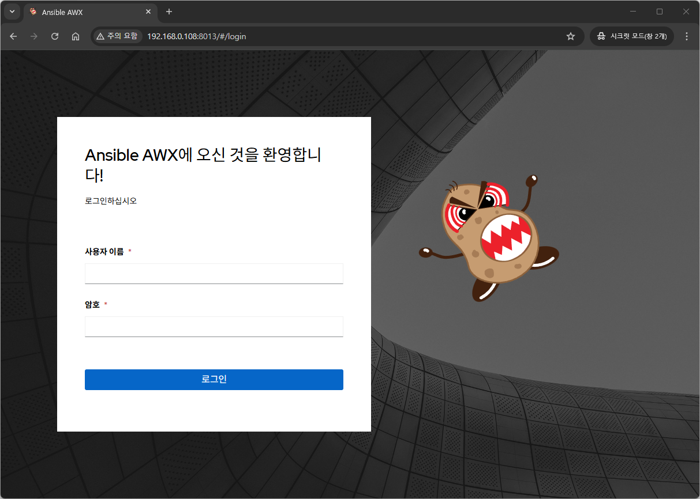
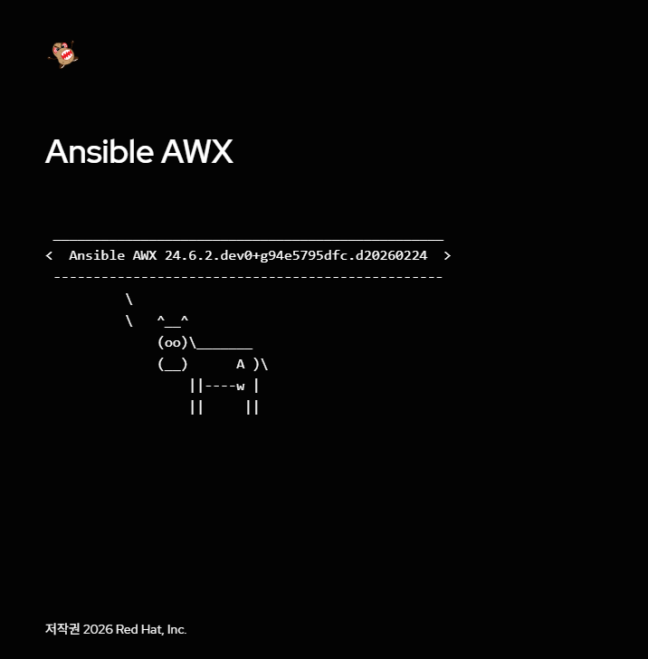
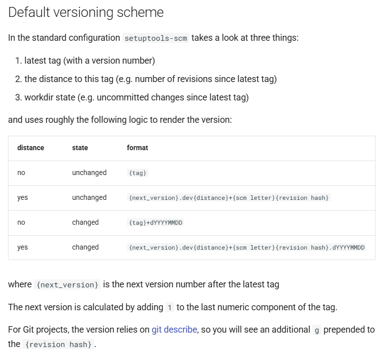

# 개요
AWX 24.6.1 버전을 도커 환경에 설치하는 방법에 대해 알아본다.

기본적으로 AWX 18.0 버전부터는 AWX Operator를 사용하여 AWX를 설치하는 것이 권장된다.
Docker 환경에 설치 및 실행할 수 있지만, 개발/테스트 용으로만 권장된다.

- [공식 문서](https://github.com/ansible/awx/blob/devel/INSTALL.md)
- [AWX 설치를 위한 환경 구성](https://susoterran.github.io/ci/cd/awx_pre_install/)

<br>

# 설치 시 주의사항
- 2026.11.01 기준 아래의 방법으로 설치 및 정상 동작을 확인했다.
- AWX 이미지의 원본이 되는 CentOS 9 Stream 이미지는 계속 최신 버전으로 갱신이 된다. 업데이트로 인해 패키지 호환이 안되는 상황이 발생할 수 있다.
- AWX 소스 코드 내부에서 github를 통해 필요한 패키지들을 다운로드 받는데 특정 버전이 아닌 가장 최신 버전 또는 개발 버전(devel)을 설치하도록 되어 있어 호환성 문제로 설치나 실행이 제대로 안되는 상황이 일어난다.
- 위의 문제들은 Docker 환경에서만 발생하기 때문에 개발/테스트 용으로만 권장한다.

<br>

# 환경 정보
AWX 이미지 빌드 및 컨테이너 실행을 위한 환경 정보는 아래와 같다.
- Rocky Linux 9.8
- Docker 29.8.2-1 (dnf로 설치. rootless 적용)
- Docker Compose 플러그인 (dnf로 설치. docker compose v2)
- Python 3.9.25 (dnf로 설치. python3, python3-pip)
- Ansible 7.5.0
- 시스템 스펙 요구 사항
  - 메모리 최소 7.5GB 이상
    - UI 빌드 시 node 힙을 최대 6GB까지 사용한다. 메모리가 부족하면 빌드 시 중간에 실패한다.

<br>

# 사전 준비

## rootless docker 

### 왜 rootless를 사용하는가
- 이전 문서에서는 `usermod -a -G docker <계정>`을 사용했다. 이 경우 docker 그룹은 root와 같다. docker 소켓을 쓸 수 있다면 docker 컨테이너 실행 시 `--privileged` 옵션으로 보안 격리를 무시하고 탈출할 수 있다. 호스트의 root 권한을 탈취한다면 다른 컨테이너와 시스템이 위험해진다.
- rootless docker 는 데몬 자체가 일반 계정 권한으로 실행된다. 컨테이너 안의 root 는 user namespace로 매핑된 호스트의 일반 계정이다. 컨테이너에서 탈출해도 해당 일반 계정의 권한만 얻을 수 있다.
- 물론 단점도 있다.
  - 컨테이너가 cgroup을 직접 만들 수 없다. AWX는 Job (ansible-playbook의 실행 단위)을 컨테이너 안의 podman으로 실행하는데, 여기서 cgroup을 만들려다가 실패하게 된다 (Job 상태는 실행 중으로 나오나 어떠한 작업도 못하는 상태가 됨)
  - 1024 미만 포트를 바로 열 수 없다.
  - 네트워크가 `slirp4netns` 를 거치다 보니 처리량이 낮아진다.
    - 컨테이너의 네트워크 트래픽을 `slirp4netns` 프로세스가 가로채서 유저 스페이스에서 프록시 형태로 처리함
  - 볼륨 및 이미지가 `/var/lib/docker` 가 아닌 계정 홈 디렉토리 아래에 위치하게 된다.

### docker 설치
- docker 설치 후 기본적으로 rootful로 동작하기 때문에 데몬이 실행되지 않도록 한다.
  ```bash
  [root@awx-host ~]# dnf config-manager --add-repo https://download.docker.com/linux/rhel/docker-ce.repo
  [root@awx-host ~]# dnf install docker-ce-29.8.2-1.el9 docker-ce-cli-29.8.2-1.el9 containerd.io \
      docker-buildx-plugin docker-compose-plugin \
      docker-ce-rootless-extras-29.8.2-1.el9 slirp4netns
  [root@awx-host ~]# systemctl disable --now docker.socket docker.service
  ```

- user namespace 매핑에 쓸 subuid/subgid 범위를 계정에 부여한다. 기본적으로 useradd 로 계정 생성 시 부여된다.
  ```bash
  [root@awx-host ~]# grep ^<계정명>: /etc/subuid /etc/subgid
  /etc/subuid:<계정명>:100000:65536
  /etc/subgid:<계정명>:100000:65536

  # 없다면 아래와 같이
  [root@awx-host ~]# usermod --add-subuids 100000-165535 --add-subgids 100000-165535 <계정명>
  ```

- rootless 설치 스크립트는 nf_tables 커널 모듈이 없으면 설치를 거부한다. 
  ```bash
  [root@awx-host ~]# modprobe nf_tables
  [root@awx-host ~]# echo nf_tables > /etc/modules-load.d/nf_tables.conf
  ```

- 일반 계정으로 rootless 데몬을 생성한다. 로그아웃해도 데몬이 살아 있도록 linger를 활성화한다.
  ```bash
  [<계정명>@awx-host ~]$ dockerd-rootless-setuptool.sh install
  [<계정명>@awx-host ~]$ systemctl --user enable --now docker
  [<계정명>@awx-host ~]$ docker context use rootless

  [root@awx-host ~]# loginctl enable-linger user
  ```

- `Security Options` 에 `rootless` 가 있는 것을 확인한다.
  ```bash
  [user@awx-host ~]$ docker info --format '{{ .SecurityOptions }}'
  [name=seccomp,profile=builtin name=rootless name=cgroupns]
  [user@awx-host ~]$ docker compose version
  Docker Compose version v5.6.0
  ```


## 빌드 환경 생성
- AWX 이미지 빌드 시 코드 내부의 Dockerfile과 compose 파일을 ansible-playbook로 실행한다.
- 그렇기 때문에 ansible을 설치하게 되며, 시스템 환경과 구별하기 위해 venv로 가상 환경을 생성하여 설치한다.
```bash
[user@awx-host ~]$ mkdir -p ~/awx-builder
[user@awx-host ~]$ python3 -m venv ~/awx-builder/venv
[user@awx-host ~]$ source ~/awx-builder/venv/bin/activate
(venv) [user@awx-host ~]$ pip install ansible==7.5.0
(venv) [user@awx-host ~]$ ansible --version
ansible [core 2.14.18]
```

- 이후 과정에서는 모두 가상 환경을 activate 한 shell에서 실행한다.

<br>

# AWX 이미지 빌드

## AWX 소스 다운로드

```bash
(venv) [user@awx-host ~]$ cd ~/awx-builder
(venv) [user@awx-host awx-builder]$ git clone -b 24.6.1 https://github.com/ansible/awx.git awx-24.6.1
(venv) [user@awx-host awx-builder]$ cd awx-24.6.1
```


## 설치 관련 설정 파일 수정

수정하는 파일은 총 5개이며, 새로 생성하는 파일은 1개이다.

| 파일  | 수정 내용 |
|-----|-------|
| `tools/ansible/roles/dockerfile/templates/Dockerfile.j2` | openssl 버전 고정 해제, pip constraints 추가 |
| `requirements/requirements.in` | django 버전 수정 |
| `requirements/requirements.txt` | django, sqlparse 버전 수정 |
| `requirements/requirements_git.txt` | ansible-runner, django-ansible-base 를 태그로 고정 |
| `tools/docker-compose/ansible/roles/sources/templates/docker-compose.yml.j2` | 재시작 정책, 버전 표시, cgroup 설정, 포트 바인딩, redis 및 postgres 이미지 고정 |
| `tools/docker-compose/custom/10-cgroups.conf` | 컨테이너 안 podman 의 cgroup 사용 해제 |


## Dockerfile.j2
- 컨테이너 이미지 생성 시 특정 버전의 패키지가 설치되도록 아래와 같이 변경한다.

### openssl-3.0.7
  - 변경 내용
    - openssl-3.0.7 → openssl (2군데)
  - Centos Stream 9에서는 최신 버전의 패키지만 설치할 수 있으며, 현재 기준에서는 3.5.2 만 설치 가능하다.
  - 변경 전
  
  ```bash
  (venv) [user@awx-host awx-24.6.1]$ vi tools/ansible/roles/dockerfile/templates/Dockerfile.j2

  ~~~~ (생략) ~~~~
  # Install build dependencies
  RUN dnf -y update && dnf install -y 'dnf-command(config-manager)' && \
      dnf config-manager --set-enabled crb && \
      dnf -y install \
      iputils \
      gcc \
      gcc-c++ \
      git-core \
      gettext \
      glibc-langpack-en \
      libffi-devel \
      libtool-ltdl-devel \
      make \
  
      nodejs \
  
      nss \
      openldap-devel \
      # pin to older openssl, see jira AAP-23449
      openssl-3.0.7 \     #### <- 변경 전
      patch \
      postgresql \
      postgresql-devel \
      python3.11 \
      "python3.11-devel" \
      "python3.11-pip" \
      "python3.11-setuptools" \
      "python3.11-packaging" \
      "python3.11-psycopg2" \
      swig \
      unzip \
      xmlsec1-devel \
      xmlsec1-openssl-devel
      
  ~~~~ (생략) ~~~~

  # Install runtime requirements
  RUN dnf -y update && dnf install -y 'dnf-command(config-manager)' && \
      dnf config-manager --set-enabled crb && \
      dnf -y install acl \
      git-core \
      git-lfs \
      glibc-langpack-en \
      krb5-workstation \
      nginx \
      "openldap >= 2.6.2-3" \
      # pin to older openssl, see jira AAP-23449
      openssl-3.0.7 \    #### <- 변경 전
      postgresql \
      python3.11 \
      "python3.11-devel" \
      "python3.11-pip*" \
      "python3.11-setuptools" \
      "python3.11-packaging" \
      "python3.11-psycopg2" \
      rsync \
      rsyslog-8.2102.0-106.el9 \
      subversion \
      sudo \
      vim-minimal \
      which \
      unzip \
      xmlsec1-openssl && \
      dnf -y clean all

  ~~~~ (생략) ~~~~
  ```
  

  - 변경 후
  
  ```bash
  (venv) [user@awx-host awx-24.6.1]$ vi tools/ansible/roles/dockerfile/templates/Dockerfile.j2

  ~~~~ (생략) ~~~~
  # Install build dependencies
  RUN dnf -y update && dnf install -y 'dnf-command(config-manager)' && \
      dnf config-manager --set-enabled crb && \
      dnf -y install \
      iputils \
      gcc \
      gcc-c++ \
      git-core \
      gettext \
      glibc-langpack-en \
      libffi-devel \
      libtool-ltdl-devel \
      make \
  
      nodejs \
  
      nss \
      openldap-devel \
      # pin to older openssl, see jira AAP-23449
      openssl \   #### <- 변경 후
      patch \
      postgresql \
      postgresql-devel \
      python3.11 \
      "python3.11-devel" \
      "python3.11-pip" \
      "python3.11-setuptools" \
      "python3.11-packaging" \
      "python3.11-psycopg2" \
      swig \
      unzip \
      xmlsec1-devel \
      xmlsec1-openssl-devel
      
  ~~~~ (생략) ~~~~

  # Install runtime requirements
  RUN dnf -y update && dnf install -y 'dnf-command(config-manager)' && \
      dnf config-manager --set-enabled crb && \
      dnf -y install acl \
      git-core \
      git-lfs \
      glibc-langpack-en \
      krb5-workstation \
      nginx \
      "openldap >= 2.6.2-3" \
      # pin to older openssl, see jira AAP-23449
      openssl \    #### <- 변경 후
      postgresql \
      python3.11 \
      "python3.11-devel" \
      "python3.11-pip*" \
      "python3.11-setuptools" \
      "python3.11-packaging" \
      "python3.11-psycopg2" \
      rsync \
      rsyslog-8.2102.0-106.el9 \
      subversion \
      sudo \
      vim-minimal \
      which \
      unzip \
      xmlsec1-openssl && \
      dnf -y clean all

  ~~~~ (생략) ~~~~
  ```
  

### pip constraints 추가
- 이미지 안의 pip가 설치할 버전을 constraints 파일로 묶는다. 묶는 패키지는 2개이다.

**1. chardet==5.2.0**
  - chardet은 requirements 파일에 등록되어있지 않지만 tox의 의존성 패키지로 최신 버전이 설치된다.
    - 2026.02.24 기준 최신 버전 : 6.0.0.post1
  - 문제는 이 최신 버전이 `requirements/requirements.txt` 에 의해 설치되는 requests 2.31.0 버전과 호환이 되지 않는다.
    - 호환되는 chardet 버전은 3.0.2 이상 6.0.0 미만이다.
    - 설치된 requests의 __init__.py 에서 확인 가능
  - requests와 chardet 간 버전 호환성이 맞지 않아 추후 awx 컨테이너 실행 시 아래와 같은 오류 메시지가 출력된다.
    ```bash
    /var/lib/awx/venv/awx/lib64/python3.11/site-packages/requests/__init__.py:109: RequestsDependencyWarning: urllib3 (1.26.18) or chardet (6.0.0.post1)/charset_normalizer (3.3.2) doesn't match a supported version!
      warnings.warn(
    ```

**2. psutil==5.9.8**
  - `requirements/requirements.txt` 는 psutil 을 5.9.8 로 고정한다. 그런데 개발용 이미지는 그 뒤에 `requirements_dev.txt` 를 설치하고, 여기에 있는 ipython 의 최신 버전(9.x)이 `psutil>=7` 을 요구해 psutil 이 7.x 로 설치된다.
    - psutil 은 AWX 가 직접 쓰는 패키지라 공식 이미지와 같은 5.9.8 로 설치한다. ipython 은 psutil 7 을 요구하지 않는 이전 버전으로 내려가며 개발용 셸이라 서비스 동작에는 영향이 없다.
  - 변경 전
  
```bash
~~~~ (생략) ~~~~
ADD requirements/requirements.txt \
    requirements/requirements_tower_uninstall.txt \
    requirements/requirements_git.txt \
    /tmp/requirements/

RUN cd /tmp && make requirements_awx
~~~~ (생략) ~~~~
```

  - 변경 후
    - 반드시 `make requirements_awx` 보다 앞에 추가해야 한다. `ENV` 는 같은 빌드 단계의 뒤쪽 `make requirements_awx_dev` 에도 적용된다.

```bash
~~~~ (생략) ~~~~
ADD requirements/requirements.txt \
    requirements/requirements_tower_uninstall.txt \
    requirements/requirements_git.txt \
    /tmp/requirements/

RUN printf '%s\n' "chardet==5.2.0" "psutil==5.9.8" > /tmp/requirements/constraints.txt
ENV PIP_CONSTRAINT=/tmp/requirements/constraints.txt

RUN cd /tmp && make requirements_awx
~~~~ (생략) ~~~~
```


## requirements_git.txt

- 기본값은 ansible-runner와 django-ansible-base를 모두 `@devel` (브랜치 최신)로 설치한다.
  - 기본값을 사용하면 컨테이너 생성 시 django 에서 admin 계정을 생성할 시에 에러가 발생하면서 이후 설치가 진행되지 않는다.
  - 검증한 조합은 ansible-runner 2.4.1, django-ansible-base 2025.5.8 이다.
    - ansible-runner 2.4.1, django-ansible-base 2025.5.8 은 AWX 24.6.1 릴리즈(2024-07)보다 뒤의 태그지만 실측에서 문제가 없었다.
    - system-certifi, python3-saml 은 태그가 없고 2024년 이후 아카이브(read-only)된 저장소라 `@devel` 이 사실상 고정이다. 그대로 둔다.
      - https://github.com/ansible/system-certifi
      - https://github.com/ansible/python3-saml

```bash
(venv) [user@awx-host awx-24.6.1]$ vi requirements/requirements_git.txt

git+https://github.com/ansible/ansible-runner.git@devel#egg=ansible-runner
=>
git+https://github.com/ansible/ansible-runner.git@2.4.1#egg=ansible-runner

django-ansible-base @ git+https://github.com/ansible/django-ansible-base@devel#egg=django-ansible-base[rest_filters,jwt_consumer,resource_registry,rbac]
=>
django-ansible-base @ git+https://github.com/ansible/django-ansible-base@2025.5.8#egg=django-ansible-base[rest_filters,jwt_consumer,resource_registry,rbac]
```


## requirements.in / requirements.txt

- django-ansible-base 2025.5.8 은 `Django>=4.2.16,<4.3.0` 과 `sqlparse>=0.5.2` 를 요구한다. 원래 고정값(`django 4.2.10`, `sqlparse 0.4.4`)으로는 `make requirements_awx` 에서 의존성 충돌로 실패한다.
- django 는 4.2 계열의 당시 최신인 4.2.21 로, sqlparse 는 0.5.2 로 변경한다.
- `requirements.in` 과 `requirements.txt` 의 django 버전을 둘 다 변경한다.
- 설치할 파이썬 모듈의 버전을 변경

```bash
(venv) [user@awx-host awx-24.6.1]$ vi requirements/requirements.in
django==4.2.10
=>
django==4.2.21

(venv) [user@awx-host awx-24.6.1]$ vi requirements/requirements.txt
django==4.2.10
=>
django==4.2.21

sqlparse==0.4.4
=>
sqlparse==0.5.2
```


## docker-compose.yml.j2
- `make docker-compose-sources` 명령어는 docker-compose.yml.j2 템플릿 파일로 `tools/docker-compose/_sources/docker-compose.yml` 을 생성한다.
**1. 재시작 정책**
  - 24.6.1 템플릿에는 `restart` 가 없어서 서버를 재부팅하면 AWX 가 실행되지 않는다.
  - `docker update --restart=always` 로 컨테이너에 직접 설정할 수 있지만, compose 가 컨테이너를 다시 만들면(`up --force-recreate` 등) 초기화된다.
  - 여기서는 정책 상 awx, redis, postgres 서비스에 `restart: unless-stopped` 를 설정한다 (`always` 를 설정해도 됨)
  - 변경 전

  ```yaml
  services:
    awx_{{ container_postfix }}:
      image: "{{ awx_image }}:{{ awx_image_tag }}"
      container_name: tools_awx_{{ container_postfix }}
      hostname: awx-{{ container_postfix }}
      command: launch_awx.sh
      environment:
        OS: "{{ os_info.stdout }}"
  ```

  - 변경 후

  ```yaml
  services:
    awx_{{ container_postfix }}:
      image: "{{ awx_image }}:{{ awx_image_tag }}"
      container_name: tools_awx_{{ container_postfix }}
      hostname: awx-{{ container_postfix }}
      restart: unless-stopped   # 추가
      command: launch_awx.sh
      environment:
        OS: "{{ os_info.stdout }}"
  ```


**2. 화면 버전 고정**
  - 자세한 사항은 문서 하단의 `부록 - 난 24.6.1을 설치했는데 왜?`를 참고한다.
  - awx 컨테이너 environment 에 `SETUPTOOLS_SCM_PRETEND_VERSION: "24.6.1"` 을 두면 setuptools_scm 이 git 을 읽지 않고 이 값을 사용하게 된다.
  - 변경 전

  ```yaml
        AWX_LOGGING_MODE: stdout
        DJANGO_SUPERUSER_PASSWORD: {{ admin_password }}
        UWSGI_MOUNT_PATH: {{ ingress_path }}
  
        RUN_MIGRATIONS: 1
  
  ```


  - 변경 후
  ```yaml
        AWX_LOGGING_MODE: stdout
        DJANGO_SUPERUSER_PASSWORD: {{ admin_password }}
        UWSGI_MOUNT_PATH: {{ ingress_path }}
        SETUPTOOLS_SCM_PRETEND_VERSION: "24.6.1"  # 추가
  
        RUN_MIGRATIONS: 1
  
  ```


**3. 컨테이너 안 podman의 cgroup 사용 해제 (rootless 전용)**
  - AWX 는 Job 을 awx 컨테이너 안에서 podman 으로 실행한다. rootless docker 에서는 이 podman 이 `/sys/fs/cgroup/libpod_parent` 를 만들 권한이 없어 모든 Job 이 아래처럼 실패한다.
  ```bash
  crun: create /sys/fs/cgroup/libpod_parent: Permission denied
  ```
  - podman 설정 파일(`/etc/containers/containers.conf.d/`)로 cgroup 사용을 끈다. 파일은 호스트에 두고 compose 가 읽기 전용으로 마운트한다.
  - AWX 화면의 "Settings → Jobs → "Container Run Options" 에 `--cgroups=disabled` 를 넣어도 같은 효과를 얻을 수 있다.
  - 변경 전
  ```bash
          - "/sys/fs/cgroup:/sys/fs/cgroup"
        - "~/.kube/config:/var/lib/awx/.kube/config"
        - "redis_socket_{{ container_postfix }}:/var/run/redis/:rw"
      privileged: true
  ```
  - 변경 후
    - 마운트 경로 `../../docker-compose/custom/...` 은 생성된 compose 파일의 위치(`tools/docker-compose/_sources/`) 기준 상대 경로다. 즉 `tools/docker-compose/custom/10-cgroups.conf` 를 가리킨다.
  ```bash
          - "/sys/fs/cgroup:/sys/fs/cgroup"
        - "~/.kube/config:/var/lib/awx/.kube/config"
        - "redis_socket_{{ container_postfix }}:/var/run/redis/:rw"
        - "../../docker-compose/custom/10-cgroups.conf:/etc/containers/containers.conf.d/10-cgroups.conf:ro"  # 추가 
      privileged: true
  ```

**4. 공개 포트 제한**
  - 템플릿은 모든 포트를 `0.0.0.0` 에 연다. AWX 앞에 nginx 같은 프록시를 두는 구성이면 프록시가 연결하는 TCP 8013 (http) 포트만 열면 된다. 
    - 특히 postgres (TCP 5441)가 외부에 열리는 것은 막아야 한다.
  - TCP 8013 을 뺀 나머지 포트 앞에 `127.0.0.1:` 을 추가한다.
    - 8043(https)을 사용한다면 수정하지 않는다.
  - 변경 전

  ```yaml
      tty: true
      ports:
        - "{{ awx_sdb_port_start }}-{{ awx_sdb_port_end }}:{{ awx_sdb_port_start }}-{{ awx_sdb_port_end }}"  # sdb-listen
  
        - "6899:6899"
        - "8080:8080"  # unused but mapped for debugging
        - "${AWX_JUPYTER_PORT:-9888}:9888"  # jupyter notebook
        - "8013:8013"  # http
        - "8043:8043"  # https
        - "2222:2222"  # receptor foo node
        - "3000:3001"  # used by the UI dev env
  
  ~~~~ (생략) ~~~~
      networks:
        - awx
      ports:
        - "${AWX_PG_PORT:-5441}:5432"
  ```

  - 변경 후

  ```yaml
      tty: true
      ports:
        - "127.0.0.1:{{ awx_sdb_port_start }}-{{ awx_sdb_port_end }}:{{ awx_sdb_port_start }}-{{ awx_sdb_port_end }}"  # sdb-listen
  
        - "127.0.0.1:6899:6899"
        - "127.0.0.1:8080:8080"  # unused but mapped for debugging
        - "127.0.0.1:${AWX_JUPYTER_PORT:-9888}:9888"  # jupyter notebook
        - "8013:8013"  # http
        - "127.0.0.1:8043:8043"  # https
        - "127.0.0.1:2222:2222"  # receptor foo node
        - "127.0.0.1:3000:3001"  # used by the UI dev env
  
  ~~~~ (생략) ~~~~
      networks:
        - awx
      ports:
        - "127.0.0.1:${AWX_PG_PORT:-5441}:5432"  # 수정
  ```


**5. redis 이미지 고정**
  - `redis:latest` 는 빌드할 때마다 다른 메이저 버전이 올 수 있다. 검증한 `redis:7.2.16` 으로 고정한다.
  - 변경 전

  ```yaml
    redis_{{ container_postfix }}:
      image: redis:latest
      container_name: tools_redis_{{ container_postfix }}
      volumes:
  ```

  - 변경 후

  ```yaml
    redis_{{ container_postfix }}:
      image: redis:7.2.16            # 수정
      container_name: tools_redis_{{ container_postfix }}
      restart: unless-stopped        # 추가 
      volumes:
  ```


**6. postgres 이미지 고정**
  - `quay.io/sclorg/postgresql-15-c9s` 는 태그 없이 받는다.
  - 혹시나 서버를 다시 만들 때 DB 이미지가 달라질 수 있으므로 digest 로 고정한다.
  - 변경 전
  ```yaml
    postgres:
      image: quay.io/sclorg/postgresql-15-c9s
      container_name: tools_postgres_1
      # additional logging settings for postgres can be found https://www.postgresql.org/docs/current/runtime-config-logging.html
  ```
  - 변경 후
  ```yaml
    postgres:
      image: quay.io/sclorg/postgresql-15-c9s:20260302@sha256:67adf4956f5d4bd5aacaa10354e5880ff3e5703988ee2cc20085c6e845fb1a20  # 수정 
      container_name: tools_postgres_1
      restart: unless-stopped               # 추가 
      # additional logging settings for postgres can be found https://www.postgresql.org/docs/current/runtime-config-logging.html
  ```

## 10-cgroups.conf
- 위 3번에서 마운트하는 podman 설정 파일이다.

```bash
(venv) [user@awx-host awx-24.6.1]$ mkdir -p tools/docker-compose/custom
(venv) [user@awx-host awx-24.6.1]$ vi tools/docker-compose/custom/10-cgroups.conf

# rootless docker 에서는 awx 컨테이너 안 podman 이 cgroup 을 만들 권한이 없다.
# Job 컨테이너가 cgroup 을 만들지 않게 한다.
[containers]
cgroups = "disabled"
```


## 이미지 빌드
- receptor 설치 시 최신 버전인 v.1.6.3 버전을 사용하도록 설정 후 이미지 빌드
  - 기본값을 사용할 경우 receptor:devel 로 설치됨
- COMPOSE_TAG: 설정하지 않는다면 기본값은 `ghcr.io/ansible/awx_devel` 이 된다. 
- RECEPTOR_IMAGE: 기본값은 `quay.io/ansible/receptor:devel` 이다. 릴리즈 버전을 v1.6.3 으로 고정한다.
- DOCKER_DEVEL_CACHE_FLAG**=**: 빈 값을 사용한다. Makefile 은 기본으로 `--cache-from=ghcr.io/ansible/awx_devel:<COMPOSE_TAG>` 를 붙여 원격 이미지를 캐시로 끌어오려 한다. 태그를 커스터마이징하게 설정했다면 원격에 없으므로 비활성화한다.
- 빌드는 수십 분 걸린다. 터미널이 끊겨도 이어지게 `nohup … > image-build.log 2>&1 &` 로 돌리는 것을 권한다.
- 빌드는 CentOS Stream 9 base, `dnf -y update`, npm 같은 외부 요소에 의존하므로 언젠가 깨질 수 있다.
  - 빌드에 성공한 이미지는 `docker save -o awx_devel-24.6.1-custom.tar ghcr.io/ansible/awx_devel:24.6.1-custom` 으로 보관해 두고, 다시 만들 때는 `docker load -i` 로 복원한다.

```bash
(awx) [user@awx-host awx-24.6.1]$ make docker-compose-build \
    COMPOSE_TAG=24.6.1-custom \
    RECEPTOR_IMAGE=quay.io/ansible/receptor:v1.6.3 \
    DOCKER_DEVEL_CACHE_FLAG=

(awx) [user@awx-host awx-24.6.1]$ docker images
IMAGE                                     ID             DISK USAGE   CONTENT SIZE   EXTRA
ghcr.io/ansible/awx_devel:24.6.1-custom   d58d2ebe9d4b       3.46GB          881MB 
```


# 서버 실행

## 컨테이너 생성
- `EXTRA_SOURCES_ANSIBLE_OPTS="-e ansible_user_uid=0"`: compose 템플릿의 awx 서비스는 `user: "{{ ansible_user_uid }}"` 로 컨테이너 프로세스의 uid 를 정하는데, 기본값은 호스트 계정의 uid(보통 1000)다.
  - rootless docker 에서는 `컨테이너 안 uid 0 = 호스트의 일반 계정` 이다(user namespace 매핑). uid 1000 은 subuid 범위의 어떤 id 로 매핑되어 호스트에서 보면 "남의 계정" 이 된다.
  - 그래서 기본값(1000)으로 띄우면 bind mount 한 소스 트리에 만들지 못하고, 컨테이너 안 podman 의 newuidmap 도 실패한다.
  - uid 0 으로 띄워도 호스트에서는 일반 계정 권한이다. rootful docker 라면 uid 0 은 진짜 root 이므로 이 옵션을 주지 않는다.

```bash
(venv) [user@awx-host awx-24.6.1]$ pip install docker   # vault 초기화 단계가 docker SDK 를 쓴다

(venv) [user@awx-host awx-24.6.1]$ make docker-compose \
    COMPOSE_TAG=24.6.1-custom \
    RECEPTOR_IMAGE=quay.io/ansible/receptor:v1.6.3 \
    COMPOSE_UP_OPTS=-d \
    EXTRA_SOURCES_ANSIBLE_OPTS="-e ansible_user_uid=0"
```


## 동작 확인

```bash
(venv) [user@awx-host awx-24.6.1]$ docker ps -a
<!-- TODO: 패치 적용 후 다시 찍기. 포트 열이 8013 만 0.0.0.0, 나머지는 127.0.0.1 이어야 한다 -->

(venv) [user@awx-host awx-24.6.1]$ curl -s -o /dev/null -w '%{http_code}\n' http://127.0.0.1:8013/api/v2/ping/
200

# admin 의 초기 비밀번호는 로그에도 찍히고 파일로도 남는다.
(venv) [user@awx-host awx-24.6.1]$ docker logs -f tools_awx_1

~~~~ (생략) ~~~~
  Applying sso.0003_convert_saml_string_to_list... OK
Superuser created successfully.
Admin password: <비밀번호 출력>
Default organization added.
Demo Credential, Inventory, and Job Template added.
(changed: True)
~~~~ (생략) ~~~~

(venv) [user@awx-host awx-24.6.1]$ cat tools/docker-compose/_sources/secrets/admin_password.yml
```


## UI 빌드
- 컨테이너는 실행되었지만 초기에는 UI 정적 파일이 없다. 컨테이너 안에서 빌드한다.

```bash
(awx) [ahrah@jslim108 awx-24.6.1]$ docker exec tools_awx_1 make clean-ui ui-devel

rm -rf node_modules
rm -rf awx/ui/node_modules
rm -rf awx/ui/build
rm -rf awx/ui/src/locales/_build
rm -rf awx/ui/.ui-built
mkdir -p awx/ui/build/static
NODE_OPTIONS=--max-old-space-size=6144 npm --prefix awx/ui --loglevel warn --force ci
npm WARN using --force Recommended protections disabled.
npm WARN deprecated source-map-url@0.4.1: See https://github.com/lydell/source-map-url#deprecated
npm WARN deprecated @babel/polyfill@7.12.1: 🚨 This package has been deprecated in favor of separate inclusion of a polyfill and regenerator-runtime (when needed). See the @babel/polyfill docs (https://babeljs.io/docs/en/babel-polyfill) for more information.

added 1884 packages, and audited 1885 packages in 51s

123 packages are looking for funding
  run `npm fund` for details

111 vulnerabilities (19 low, 48 moderate, 39 high, 5 critical)

To address issues that do not require attention, run:
  npm audit fix

To address all issues possible (including breaking changes), run:
  npm audit fix --force

Some issues need review, and may require choosing
a different dependency.

Run `npm audit` for details.
npm notice 
npm notice New major version of npm available! 8.5.0 -> 12.2.0
npm notice Changelog: <https://github.com/npm/cli/releases/tag/v12.2.0>
npm notice Run `npm install -g npm@12.2.0` to update!
npm notice 
make[1]: Entering directory '/awx_devel'
make awx/ui/node_modules
make[2]: Entering directory '/awx_devel'
NODE_OPTIONS=--max-old-space-size=6144 npm --prefix awx/ui --loglevel warn --force ci
npm WARN using --force Recommended protections disabled.
npm WARN deprecated source-map-url@0.4.1: See https://github.com/lydell/source-map-url#deprecated
npm WARN deprecated @babel/polyfill@7.12.1: 🚨 This package has been deprecated in favor of separate inclusion of a polyfill and regenerator-runtime (when needed). See the @babel/polyfill docs (https://babeljs.io/docs/en/babel-polyfill) for more information.

added 1884 packages, and audited 1885 packages in 22s

123 packages are looking for funding
  run `npm fund` for details

111 vulnerabilities (19 low, 48 moderate, 39 high, 5 critical)

To address issues that do not require attention, run:
  npm audit fix

To address all issues possible (including breaking changes), run:
  npm audit fix --force

Some issues need review, and may require choosing
a different dependency.

Run `npm audit` for details.
make[2]: Leaving directory '/awx_devel'
python3.11 tools/scripts/compilemessages.py
/awx_devel/tools/scripts/compilemessages.py:59: DeprecationWarning: 'locale.getdefaultlocale' is deprecated and slated for removal in Python 3.15. Use setlocale(), getencoding() and getlocale() instead.
  encoding = locale.getdefaultlocale()[1] or 'ascii'
processing file django.po in /awx_devel/awx/locale/en-us/LC_MESSAGES

processing file django.po in /awx_devel/awx/locale/es/LC_MESSAGES

processing file django.po in /awx_devel/awx/locale/fr/LC_MESSAGES

processing file django.po in /awx_devel/awx/locale/ja/LC_MESSAGES

processing file django.po in /awx_devel/awx/locale/ko/LC_MESSAGES

processing file django.po in /awx_devel/awx/locale/nl/LC_MESSAGES

processing file django.po in /awx_devel/awx/locale/zh/LC_MESSAGES

npm --prefix awx/ui --loglevel warn run compile-strings

> compile-strings
> lingui compile

Compiling message catalogs…
Done!
npm --prefix awx/ui --loglevel warn run build

> build
> INLINE_RUNTIME_CHUNK=false react-scripts build

Creating an optimized production build...
Browserslist: caniuse-lite is outdated. Please run:
  npx update-browserslist-db@latest
  Why you should do it regularly: https://github.com/browserslist/update-db#readme
```


## AWX 접속
앞서 확인한 admin 의 임시 패스워드를 통해 접속한다. 접속 시 다음의 tcp 포트를 이용하면 된다.
- http 포트 : TCP 8013
- https 포트 : TCP 8043


<br><br>


<br>

# 난 24.6.1을 설치했는데 왜?


AWX 이미지를 빌드할 때 파이썬의 동적 버전 관리 도구 `setuptools_scm`을 사용한다. 이 도구는 현재 소스코드 폴더의 git 상태를 실시간으로 읽어서 버전을 결정한다. 앞서 Dockerfile.j2 파일 등을 수정했는데 원래의 24.6.1 공식 소스코드에서 파일이 하나라도 수정되면 (Dirty state) setuptools_scm 은 사용자가 수정한 커스텀 버전으로 인식하게 된다.
setuptools_scm 에 의해 버전이 변경되는 공식은 다음과 같다.



[공식 문서](https://setuptools-scm.readthedocs.io/en/latest/usage/)

<br>


# 참고자료
[Docker Compose for Development](https://github.com/ansible/awx/blob/devel/tools/docker-compose/README.md)
<br>
[Run the latest Ansible AWX in Docker containers](https://www.ansiblepilot.com/articles/run-the-latest-ansible-awx-in-docker-containers/#run-ansible-in-docker-containers)
<br>
[Basic Setup and Use of Podman in a Rootless environment](https://github.com/containers/podman/blob/main/docs/tutorials/rootless_tutorial.md)
